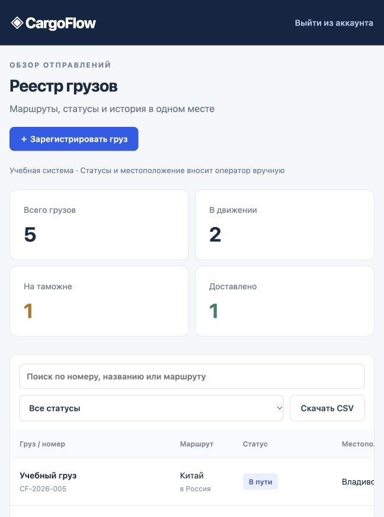
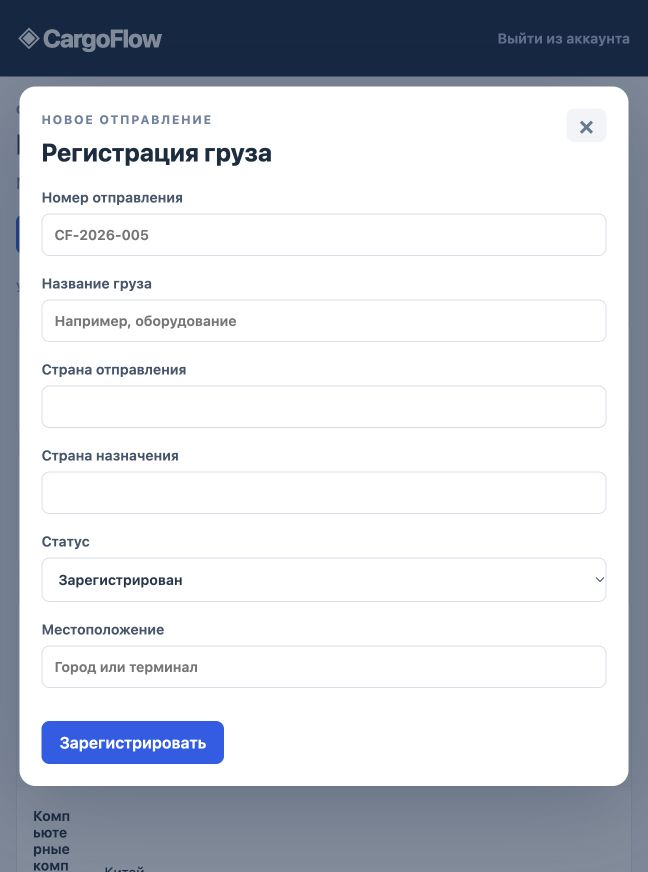
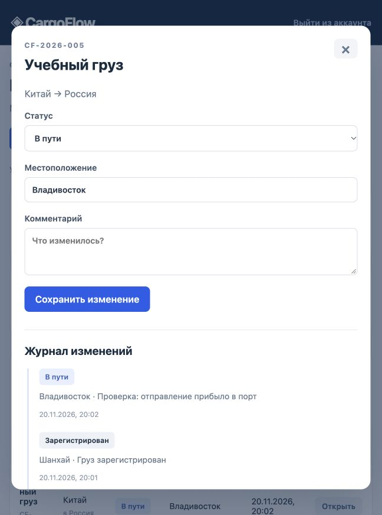

# 1. Система отслеживания грузов

CargoFlow — учебное веб-приложение для регистрации международных грузов, просмотра состояния и истории обновлений. В поставке две версии с одним интерфейсом: серверная на Python и браузерная демонстрация для GitHub Pages.

## 2. Цель разработки

Создать рабочее место для учёта грузов: сохранять карточки, быстро находить отправление, видеть направление перевозки, статус, местоположение и время обновления, выгружать реестр в CSV.

## 3. Какую проблему решает приложение

При учёте в таблицах и переписках трудно восстановить актуальное состояние груза и последовательность изменений. CargoFlow объединяет карточку и журнал событий. Статусы в обеих версиях вводит оператор. Связи с GPS, перевозчиками и таможенными базами нет.

## 4. Используемые технологии

| Компонент | Серверная версия | Браузерная демоверсия |
|---|---|---|
| Интерфейс | HTML, CSS, JavaScript | Тот же интерфейс |
| Логика | Python 3, HTTP API | JavaScript, `browser-demo.js` |
| Хранилище | SQLite, локальный файл | localStorage данного браузера |
| Время событий | Часы сервера, UTC | Часы устройства, запись в UTC |
| Вход | Проверка на сервере, cookie-сессия | Учебная проверка в браузере, sessionStorage |
| Экспорт | CSV, формирует Python | CSV, формирует JavaScript |
| Публикация | Нужен хостинг с Python | Статические файлы GitHub Pages |

Для серверной версии достаточно стандартной библиотеки Python. Платные сервисы и отдельный сервер СУБД для локального показа не нужны. GitHub хранит исходники и историю версий.

## 5. Основные функциональные возможности

- Регистрация и вход пользователя.
- Создание карточки: номер, название груза, страны отправления и назначения, статус и местоположение.
- Уникальный номер в пределах реестра пользователя.
- Пять статусов: «Зарегистрирован», «В пути», «На таможне», «Выпущен», «Доставлен».
- Обновление статуса и местоположения с комментарием.
- Журнал начального состояния и последующих сохранений с датой и временем.
- Поиск, фильтр статуса и CSV всего реестра пользователя.
- Сохранение данных между открытиями: в SQLite либо localStorage, в зависимости от версии.

В интерфейсе обеих версий операции одинаковы. Защита данных различается: сервер проверяет владельца на стороне Python, а браузерная демонстрация не создаёт доверенной границы доступа. Владелец браузера может изменить localStorage и учебный сеанс через инструменты разработчика.

## 6. Инструкция по использованию

### Вариант А. Полная серверная версия

В терминале в папке проекта:

```bash
python3 server.py --demo
```

Откройте [http://127.0.0.1:8080](http://127.0.0.1:8080). Демо-вход: **demo / demo12345**. На Windows можно выполнить `py -3 server.py --demo`. Есть файлы быстрого запуска `start.command` и `start.bat`.

Другой порт и отдельная база:

```bash
python3 server.py --db practice.db --port 8081
```

Не закрывайте терминал во время показа. Остановка: `Ctrl+C`. Записи сохраняются в файле базы, сеансы входа после перезапуска сервера нужно создать заново. Для резервной копии остановите сервер и скопируйте базу. Рабочая база не входит в поставку исходников.

### Вариант Б. Статическая демонстрация для GitHub Pages

**Рабочий сайт:** [nadya420.github.io/cargo-tracker](https://nadya420.github.io/cargo-tracker/). Преподавателю не нужно запускать Python. **Демо-вход: demo / demo12345.**

**Онлайн-презентация:** [19 слайдов с анимациями](https://nadya420.github.io/cargo-tracker/presentation.html).

Публикация и основной сценарий проверены 20 ноября 2026 года. Источник Pages: main / (root), HTTPS.

На GitHub Pages приложение автоматически выбирает браузерную демоверсию. Для проверки её локально выполните:

```bash
python3 -m http.server 8090
```

Откройте [http://127.0.0.1:8090/?mode=browser](http://127.0.0.1:8090/?mode=browser). Здесь Python только раздаёт файлы и не выполняет бизнес-логику. Демо-вход тот же: **demo / demo12345**. Нужен современный браузер, HTTPS или localhost, разрешённые localStorage и sessionStorage.

Данные демоверсии принадлежат конкретному браузеру и адресу сайта. Они не синхронизируются между устройствами и не попадают в SQLite. Очистка данных сайта удалит их. Сеанс ограничен восемью часами и хранится в sessionStorage. Используйте только вымышленные сведения и учебные пароли.

### Рабочий сценарий

1. Войдите или зарегистрируйте учебную учётную запись.
2. Создайте груз с новым номером, названием, странами, статусом и местоположением.
3. Найдите его по номеру и откройте карточку.
4. Измените статус/местоположение и добавьте комментарий.
5. Покажите новое состояние и журнал с временными отметками.
6. Нажмите «Скачать CSV». Выгружается весь реестр, а не только текущий результат фильтра.

«Отслеживание времени» означает дату и время сохранения сведений. Расчёт ETA, дедлайнов и длительности пути не реализован.

### Публикация в GitHub Pages

Целевой репозиторий: [Nadya420/cargo-tracker](https://github.com/Nadya420/cargo-tracker). Файлы публикуются из аккаунта владелицы репозитория. В GitHub история коммитов сохраняет фактического автора загрузки.

1. Войти в GitHub под аккаунтом владелицы и открыть репозиторий.
2. Сохранить прежнюю версию через Code → Download ZIP. При обновлении через Git история прежних коммитов также сохраняется.
3. Загрузить актуальные файлы в корень ветки main через Add file → Upload files. В корне должны находиться index.html, app.js, browser-demo.js, style.css, presentation.html и .nojekyll.
4. Не загружать рабочую базу cargo.db и личные данные. Учебные примеры создаются автоматически при запуске.
5. В Settings → Pages выбрать Deploy from a branch, ветку main, папку /(root), затем Save.
6. Дождаться успешного развёртывания, открыть Visit site и проверить вход, карточку, журнал и CSV.
7. Вписать подтверждённую рабочую ссылку в README и передать её преподавателю вместе со ссылкой на репозиторий.

Порядок соответствует [официальной настройке GitHub Pages](https://docs.github.com/en/pages/getting-started-with-github-pages/configuring-a-publishing-source-for-your-github-pages-site). GitHub Pages [не запускает Python](https://docs.github.com/en/pages/getting-started-with-github-pages/creating-a-github-pages-site), поэтому публичный сайт использует браузерный адаптер. Python и SQLite доступны в локальной серверной версии.

## 7. Скриншоты интерфейса

Реальные снимки запущенной серверной версии:







Материалы защиты: [презентация](presentation.html), [инструкция показа](PRESENTATION_GUIDE.md), [выступление](DEFENSE.md), [вопросы преподавателя](TEACHER_QA.md), [требования](REQUIREMENTS.md), [результаты проверки](QA.md).

## Презентация и развитие

В презентации 19 последовательных слайдов с анимациями, оглавлением, заметками, полноэкранным режимом и печатью/PDF. Отдельного сокращённого режима нет. Самодостаточный HTML работает без интернета.

Следующие этапы: справочник стран, плановые сроки и уведомления, роли, интеграции с перевозчиками. Для реального использования нужны отдельный аудит безопасности, серверное хранение, HTTPS, резервные копии и нагрузочные испытания. Браузерная версия предназначена только для учебного показа.
